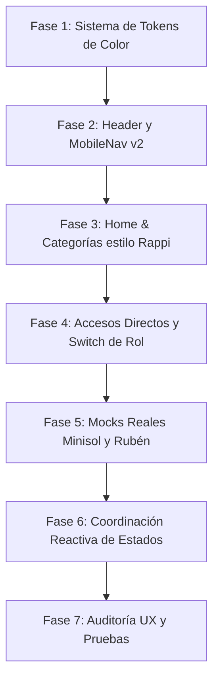

# Plan de Trabajo: Rediseño UI/UX e Integración Funcional — Quickly Delivery

Basado en el **Audio de requerimientos (21/10/2026)**, el **Prototipo v2 (`docs/protipo_v2.jpeg`)**, las reglas de diseño de `quickly-ui` y el contexto local de **Tingo María**.

---

## 1. Diagnóstico y Síntesis de Requerimientos

### 1.1. Puntos clave extraídos del audio
* **Nueva Paleta Cromática:** Sustitución definitiva del acento *Berry Carmine* (#BE185D) por una combinación limpia y contrastada:
  - **Verde Claro / Primario:** Verde energizante y fresco (`#00A859` / `#10B981`) para acciones principales, botones de compra, branding y acentos.
  - **Verde Oscuro:** Verde selva profunda (`#065F46` / `#064E3B`) para cabeceras, contrastes, badges de éxito y textos sobre fondos claros.
  - **Negro / Ink Profundo:** `#111827` / `#172033` para tipografía principal, legibilidad extrema bajo la luz solar.
  - **Blanco Puro:** `#FFFFFF` para tarjetas, inputs, modales y fondos de módulos.
* **Reducción radical de carga textual ("Menos letras, más visual estilo Rappi"):**
  - Eliminar párrafos extensos y explicaciones redundantes.
  - Comunicación mediante jerarquía visual inmediata: íconos autoexplicativos, etiquetas de 1 a 2 palabras y micro-copys de impacto rápido (lectura en < 3 segundos).
* **Gestión del espacio visual e íconos más protagónicos:**
  - Evitar huecos blancos vacíos o desproporcionados rellenándolos con fondos suaves de color (`bg-selva-soft`, contenedores redondeados).
  - Agrandar íconos táctiles (≥ 44×44 px de área táctil según Ley de Fitts).
* **Coordinación y funcionalidad real entre módulos:**
  - Que cada botón, filtro, selector y acceso directo esté plenamente coordinado con el estado global de la aplicación (Zustand), sin componentes estáticos o "de adorno".
* **Comercios y productos locales de Tingo María:**
  - Incorporación de **Minisol** (supermercado/minimarket referente en Tingo María) y **Rubén** (comercio de comida tradicional), integrando soporte para catálogos con SKU, códigos de barra y códigos QR de validación.

---

## 2. Matriz de Cambios por Componente (Prototipo v2)

| Elemento en Prototipo v2 | Estado Actual | Modificación Requerida | Prioridad |
| :--- | :--- | :--- | :--- |
| **Cabecera Superior** | Fondo blanco con acentos magenta | Fondo verde vibrante (`bg-selva-strong` o `#00A859`), logo con repartidor blanco, campana con badge, carrito y perfil | Alta |
| **Buscador Principal** | Input estándar dentro de layout | Barra blanca con bordes redondeados y lupa integrada dentro del bloque verde de cabecera | Alta |
| **Filtros de Zona y Categoría** | Selectores en barra blanca | Píldoras interactivas flotantes: `Categorías ⌄` y `📍 Tingo María • Zona Centro ⌄` | Alta |
| **Indicador de Entrega** | Texto pequeño disperso | Píldora visible: `🕒 Despachos en 20 - 35 min` | Media |
| **Hero Carousel** | 3 slides con párrafos largos | Banner sintético: título en 2 líneas, sin párrafos densos, botón píldora `Ver categorías →` y foto local con mockup de móvil | Alta |
| **Grilla de Categorías** | 5 categorías con iconos pequeños | 5 tarjetas grandes redondeadas con iconos verdes protagonistas: *Restaurantes, Bodegas, Farmacias, Ropa, Emprendedores* | Alta |
| **Accesos Directos** | Enlaces estándar de texto | Píldoras de acceso rápido: `% Ofertas`, `📋 Pedidos`, `🕒 Mis pedidos`, `💚 Favoritos` + Switch de rol `● Panel: CLIENTE ⌃` | Alta |
| **MobileNav Inferior** | Barra con 5 pestañas magenta | 5 accesos con acento verde y área táctil de 44 px: *Inicio, Buscar, Pedidos, Favoritos, Perfil* | Media |
| **Catálogo de Comercios** | Mocks genéricos de comida | Fichas reales de **Minisol** y **Rubén**, con tiempos reales por zona y productos verificados | Alta |

---

## 3. Fases de Ejecución del Plan de Trabajo

### Fase 1: Actualización de Tokens de Color y Sistema de Diseño
* **Objetivo:** Migrar la identidad visual de Berry Carmine a la paleta oficial Verde Claro, Verde Oscuro, Negro y Blanco.
* **Archivos a modificar:**
  - `src/styles/index.css`: Reconfigurar variables `--color-primary`, `--color-primary-hover`, `--color-primary-50` hacia la nueva gama verde.
  - `tailwind.config.js`: Ajustar los tokens semánticos correspondientes.
  - `src/components/shared/BrandLogo.tsx`: Actualizar isotipo (repartidor en silueta blanca/verde) y variantes cromáticas.
* **Criterio de Aceptación:** Contraste WCAG AA verificado (≥ 4.5:1 para texto sobre fondo blanco y ≥ 3:1 para elementos de interfaz).

### Fase 2: Rediseño de Cabecera Superior y Navegación Móvil
* **Objetivo:** Implementar la cabecera verde unificada del prototipo v2.
* **Archivos a modificar:**
  - `src/components/shared/Navbar.tsx`: Crear la vista móvil con fondo verde, menú hamburguesa, logo, notificaciones con badge dinámico y perfil.
  - `src/components/shared/SearchBar.tsx`: Estilizar el buscador en formato píldora blanca incrustada en la cabecera.
  - `src/components/shared/ZoneSelector.tsx`: Adaptar el selector a la píldora compacta `📍 Tingo María • Zona Centro ⌄`.
  - `src/components/shared/MobileNav.tsx`: Actualizar estados activo/inactivo con la nueva paleta y los 5 iconos exactos del prototipo.
* **Criterio de Aceptación:** Cabecera adaptable y fija sin desbordamiento horizontal en resoluciones móviles (360px - 414px).

### Fase 3: Optimización del Home: Síntesis Visual Estilo "Rappi"
* **Objetivo:** Reducir textos densos, agrandar íconos y eliminar espacios vacíos.
* **Archivos a modificar:**
  - `src/features/catalog/HomePage.tsx`:
    - Reducir el texto del hero banner a un micro-copy contundente: *"Todo lo que necesitas, en un solo lugar"*.
    - Reemplazar el slider pesado por un carrusel ligero con indicadores de puntos (dots).
    - Rediseñar las 5 tarjetas de categorías principales (*Restaurantes, Bodegas, Farmacias, Ropa, Emprendedores*) con mayor tamaño de ícono y fondos suaves (`bg-selva-soft`).
* **Criterio de Aceptación:** Reconocimiento visual instantáneo en menos de 3 segundos; touch targets de al menos 44×44 px.

### Fase 4: Módulo de Accesos Directos y Selector de Panel
* **Objetivo:** Implementar la barra interactiva de accesos directos y el conmutador de perfil.
* **Archivos a modificar / crear:**
  - `src/components/shared/QuickAccessBar.tsx` (o integrado en `HomePage.tsx`):
    - Píldoras interactivas con navegación a `/promociones`, `/pedidos`, `/cliente/pedidos` y `/cliente/favoritos`.
    - Selector interactivo `● Panel: CLIENTE ⌃` conectado con `useAuthStore` (para alternar fluidamente entre Cliente, Comercio, Repartidor y Admin).
* **Criterio de Aceptación:** Cada acceso directo responde al clic y navega a la sección correcta o activa el modal correspondiente.

### Fase 5: Incorporación de Comercios Locales (Minisol y Rubén) y Catálogo con SKU/QR
* **Objetivo:** Dar respaldo y realismo al catálogo con comercios icónicos de Tingo María mencionados en el audio.
* **Archivos a modificar:**
  - `src/mocks/initialData.ts`:
    - Registrar **Minisol** (categoría bodegas/supermercados, ubicación en Centro de Tingo María, productos de abarrotes, lácteos, productos regionales con códigos SKU y soporte QR).
    - Registrar **Rubén** (categoría restaurantes, especialidades tradicionales de Tingo María).
  - `src/domain/types.ts`: Asegurar campos para código de barras / SKU / QR en productos.
  - `src/features/catalog/ProductDetailModal.tsx`: Mostrar código de producto y chip informativo de validación rápida.
* **Criterio de Aceptación:** Ambos comercios aparecen en el catálogo, filtrables por su respectiva categoría, y sus productos pueden añadirse al carrito.

### Fase 6: Coordinación y Funcionalidad Reactiva Integral
* **Objetivo:** Asegurar que cada componente coordiné sus datos sin discrepancias.
* **Componentes a sincronizar:**
  - Filtro de categoría: Al hacer clic en "Farmacias", "Bodegas", etc., filtra reactivamente la lista de comercios y productos.
  - Selector de Zona: Cambiar de "Centro" a "Castillo Grande" o "Rupa Rupa Norte" recalcula inmediatamente las tarifas de delivery y los tiempos estimados.
  - Carrito Flotante (`FloatingCartBar`): Actualización instantánea de cantidad y precio formateado con `formatCents`.
* **Criterio de Aceptación:** Cero estados congelados o desincronizados entre vistas móvil y escritorio.

### Fase 7: Validación de Calidad, Principios UX y Build
* **Objetivo:** Verificar conformidad con `quickly-ui` y `ux-principles-reviewer`.
* **Verificaciones:**
  - [x] Contraste de colores verificado bajo luz solar (WCAG AA).
  - [x] Ejecución de linters y verificación TypeScript (`npm run build`).
  - [x] Sin scroll horizontal en pantallas móviles (360px a 428px).
  - [x] Pruebas de usabilidad con teclado y lectores de pantalla.

---

## 4. Cronograma de Entregables Estimado

| Hito | Entregable Principal | Estado |
| :--- | :--- | :--- |
| **Hito 1** | Tokens de color verde/negro/blanco y BrandLogo renovado | Por iniciar |
| **Hito 2** | Cabecera y MobileNav con diseño exacto del Prototipo v2 | Por iniciar |
| **Hito 3** | Home optimizado (menos texto, iconos agrandados, carrusel con dots) | Por iniciar |
| **Hito 4** | Accesos directos y conmutador de panel de usuario | Por iniciar |
| **Hito 5** | Fichas y catálogo real de Minisol y Rubén con SKU/QR | Por iniciar |
| **Hito 6** | Pruebas integrales de flujo y validación de build | Por iniciar |
